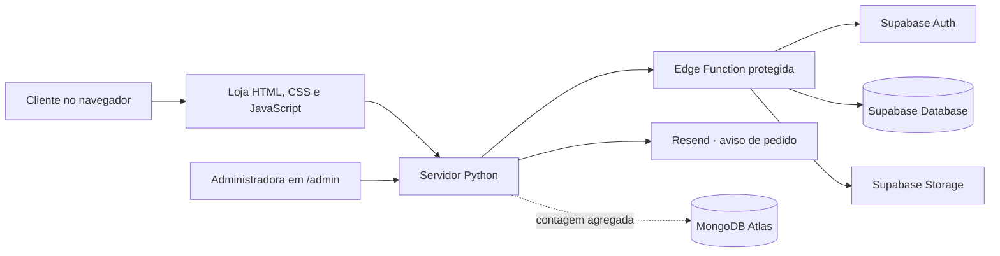

# Estrela Concept

<p align="center">
  
</p>

<p align="center"><strong>Seu estilo, seu brilho.</strong><br>Loja virtual de moda fitness com atendimento próximo pelo WhatsApp.</p>

<p align="center">
  <a href="https://estrela-concept.onrender.com/">Abrir a loja</a> ·
  <a href="https://github.com/guilhermeestrela10/estrela-concept">Repositório no GitHub</a>
</p>

> **Estado do projeto:** demonstração funcional em `https://estrela-concept.onrender.com`. O código mais recente está na branch `main`; o catálogo ainda contém produtos de exemplo e algumas integrações de produção dependem de configuração externa. Veja a lista de conclusão no fim deste documento antes de abrir a loja para vendas.

## Sobre o projeto

A **Estrela Concept** é uma loja online para apresentar roupas fitness e facilitar pedidos pelo celular ou computador. A vitrine permite explorar as peças e montar uma sacola; o sistema registra o pedido e a equipe combina pagamento, entrega, trocas, devoluções e dúvidas diretamente com a cliente pelo WhatsApp.

O projeto atende dois públicos:

- **Clientes:** navegam pelo catálogo, conferem fotos, tamanhos, cores e disponibilidade e enviam um pedido com nome e WhatsApp.
- **Administradora:** entra em uma página restrita para atualizar produtos, imagens, categorias e estoque, acompanhar pedidos e abrir uma conversa com a cliente.

O site não processa pagamentos, não calcula frete e não confirma uma venda paga. O pedido é o início do atendimento, e as condições são acertadas pelo WhatsApp **+55 86 99926-9836**.

## O que já está implementado

### Loja

- Layout responsivo alinhado à identidade visual aprovada.
- Busca e filtros por categoria, tamanho e faixa de preço.
- Página de detalhes com galeria de fotos e opções de variação.
- Sacola persistida no navegador.
- Validação de disponibilidade no servidor e baixa de estoque transacional ao criar pedido.
- Atalho para continuar o atendimento pelo WhatsApp.

### Painel administrativo

- Acesso pela rota direta `/admin`; o link não é exibido na navegação pública.
- Login, sessão administrativa, saída e fluxo de recuperação de senha pelo Supabase Auth.
- Cadastro e edição de produtos, categorias, preços, variações e estoque.
- Envio de até 10 imagens por produto em JPEG, PNG ou WebP (até 4 MB por arquivo), além de imagens por URL HTTPS.
- Acompanhamento e atualização de status de pedidos, com atalho para chamar a cliente pelo WhatsApp.
- Indicadores calculados a partir dos dados já carregados no painel para evitar uma consulta repetida ao banco.
- Lista dos cinco produtos mais vistos, com contagem agregada no MongoDB Atlas; a loja funciona mesmo se essa integração estiver indisponível.

### Avisos por e-mail

Quando o pedido é gravado, o servidor tenta enviar uma notificação para o e-mail da loja pela API HTTPS do Resend. A mensagem mostra os itens, o total e um botão para abrir o painel. O telefone da cliente fica somente no painel, que exige login. Uma falha no e-mail não cancela o pedido; no momento, avisos com falha não são reenviados automaticamente. O pedido continua disponível no painel.

## Como funciona



O navegador conversa com o servidor Python. O servidor usa uma Edge Function para acessar dados e operações administrativas do Supabase. A chave de serviço do Supabase permanece no ambiente Supabase; o token privado usado pelo servidor é configurado como segredo na hospedagem. As fotos do catálogo ficam no Supabase Storage. O MongoDB Atlas é complementar: guarda apenas um contador agregado por produto sempre que os detalhes são abertos. Pedidos, clientes, estoque e autenticação continuam no armazenamento atual. Sem Atlas configurado, vitrine e checkout seguem funcionando; apenas o resumo de visualizações fica indisponível.

## Tecnologias

| Parte | Tecnologia |
| --- | --- |
| Vitrine e painel | HTML, CSS e JavaScript nativos |
| Servidor web e API | Python 3.10+ e biblioteca padrão |
| Dados e autenticação | Supabase Database e Supabase Auth |
| Fotos | Supabase Storage |
| Operações protegidas | Supabase Edge Functions e PostgreSQL |
| Métricas agregadas | MongoDB Atlas com PyMongo |
| Hospedagem atual | Render |
| Testes automatizados | `unittest` e SQLite temporário |

Para instalar a dependência opcional das métricas localmente, use `python -m pip install -r requirements.txt`. O Render também instala esse arquivo durante a compilação.

## Executar localmente

### Requisitos

- Python 3.10 ou superior.
- Token privado `ESTRELA_EDGE_API_TOKEN` configurado para conectar ao Supabase.

O servidor pode ler o token do arquivo `%LOCALAPPDATA%\Estrela Concept\edge_api.key`. Como alternativa, configure-o apenas na sessão atual do PowerShell:

```powershell
$env:ESTRELA_EDGE_API_TOKEN = "SEU_TOKEN_PRIVADO"
python server.py
```

Abra no navegador:

- Loja: <http://127.0.0.1:8000>
- Painel: <http://127.0.0.1:8000/admin>
- Estado da conexão: <http://127.0.0.1:8000/api/status>

O servidor usa `127.0.0.1:8000` por padrão. `HOST` e `PORT` podem ser configurados por variáveis de ambiente. Encerre com `Ctrl+C` no terminal.

Se o Supabase não estiver acessível ou o token não estiver configurado, as rotas de dados exibem um erro. O sistema não troca silenciosamente para outro banco. SQLite é utilizado pelos testes.

## Configuração do serviço publicado

O serviço Render utiliza as seguintes variáveis de ambiente. Cadastre os valores privados diretamente no painel do Render; não os grave neste repositório.

| Variável | Uso |
| --- | --- |
| `ESTRELA_EDGE_API_TOKEN` | Segredo para o servidor chamar a Edge Function |
| `RESEND_API_KEY` | Chave secreta usada para enviar notificações pelo Resend |
| `RESEND_FROM_EMAIL` | Remetente autorizado no Resend; durante testes, o padrão é `Estrela Concept <onboarding@resend.dev>` |
| `ORDER_NOTIFICATION_EMAIL` | Endereço que recebe os avisos de novos pedidos |
| `ADMIN_PANEL_URL` | Link do painel incluído no e-mail; padrão atual: `https://estrela-concept.onrender.com/admin` |
| `MONGODB_URI` | URI privada de conexão com o Atlas; configurar diretamente no Render, nunca no Git |
| `MONGODB_DATABASE` | Banco das métricas; opcional, padrão `estrela_concept` |
| `HOST` / `PORT` | Endereço e porta do servidor; o Render define a porta |

No Render, use o Resend pela API HTTPS. O plano gratuito do Render bloqueia conexões SMTP de saída nas portas 25, 465 e 587, usadas pelo Gmail ([limitações oficiais](https://render.com/docs/free)). Crie uma chave no Resend e configure-a diretamente no painel do Render; nunca a grave no Git. Para usar um endereço próprio como remetente, verifique o domínio no Resend e cadastre o endereço em `RESEND_FROM_EMAIL`. O remetente de teste `onboarding@resend.dev` serve apenas para os testes permitidos pelo Resend. Ative também as notificações do Gmail no celular da loja.

Fora do Render, o desenvolvimento local ainda pode usar `GMAIL_SMTP_USER` e `GMAIL_APP_PASSWORD` como alternativa. No Render, essas variáveis não substituem a chave do Resend.

### MongoDB Atlas — visualizações agregadas

Ao abrir os detalhes de um produto ativo, o servidor incrementa um único contador agregado identificado pelo ID do produto. O painel administrativo mostra até cinco produtos mais vistos. Não são armazenados nome, telefone, endereço IP, sessão ou registros individuais de navegação no MongoDB. Produtos, pedidos, clientes, estoque e autenticação continuam no banco atual. Se o Atlas estiver ausente ou temporariamente indisponível, as métricas ficam indisponíveis, mas a loja e o checkout continuam operando.

Para ativar as métricas no Render, crie ou use um usuário de aplicação no Atlas com acesso somente de leitura e escrita ao banco das métricas, depois cadastre `MONGODB_URI` em **Environment** no serviço. A URI deve ser tratada como senha e não deve ser enviada por chat nem gravada em arquivos versionados. `MONGODB_DATABASE` é opcional. Restrinja o acesso de rede do Atlas às origens de saída do serviço sempre que possível. O banco e a coleção `product_views` são utilizados pela aplicação; não é necessário inserir documentos manualmente.

## Banco e arquivos do Supabase

O projeto já utiliza o Supabase associado à loja. O arquivo `supabase/schema.sql` descreve tabelas, regras e operações do banco; não o execute novamente no projeto publicado sem verificar as migrações existentes. A função `supabase/functions/estrela-api/` implementa operações protegidas, como login administrativo, pedidos, atualização do catálogo e upload de imagens.

O catálogo existente contém dados de demonstração. O arquivo `catalog.py` oferece dados usados no armazenamento temporário dos testes, não é o cadastro oficial dos produtos publicados.

## Segurança e privacidade

- Segredos de servidor não são enviados ao navegador nem devem ser commitados.
- A interface do painel faz parte do site e seu código é público neste repositório; a proteção dos dados depende da autenticação e das verificações no servidor e no Supabase, não de esconder a URL.
- Operações administrativas e dados de pedidos exigem sessão autenticada.
- O painel utiliza cookies de sessão com validade limitada e proteção contra requisições de outras origens.
- A criação de pedido valida os dados e atualiza o estoque em uma transação no banco.
- O upload de imagens verifica formato, conteúdo e tamanho.
- O e-mail de aviso não inclui telefone nem outros dados pessoais da cliente.
- O servidor envia resposta genérica para falhas internas e registra detalhes técnicos somente nos logs.

**Limite conhecido:** a proteção do Supabase contra senhas vazadas não está habilitada no plano atual. As credenciais administrativas também foram compartilhadas durante a configuração da demonstração. Reavalie a troca da senha e das chaves compartilhadas, e ative proteções disponíveis, antes de abrir a loja ao público.

### Variáveis e chaves

O endereço do projeto Supabase e a chave `sb_publishable_...` aparecem no código por serem identificadores e chave pública do cliente. A chave publicável pode ser distribuída, desde que o acesso às tabelas continue protegido por RLS e permissões mínimas. A auditoria atual confirmou RLS em todas as tabelas `public` e nenhum privilégio de tabela ou função concedido a `anon`, `authenticated` ou `PUBLIC`. Consulte as [regras oficiais do Supabase para chaves publicáveis e secretas](https://supabase.com/docs/guides/getting-started/api-keys).

Estas configurações são privadas e devem existir apenas no serviço que as usa, nunca no Git:

| Segredo | Onde configurar |
| --- | --- |
| `ESTRELA_EDGE_API_TOKEN` | Render; no computador local, arquivo fora do projeto em `%LOCALAPPDATA%\Estrela Concept\edge_api.key` |
| `SUPABASE_SECRET_KEYS` ou `SUPABASE_SERVICE_ROLE_KEY` | Segredos do runtime da Edge Function no Supabase |
| `RESEND_API_KEY` | Variáveis privadas do Render |
| `GMAIL_APP_PASSWORD` | Apenas no ambiente local, se usar o SMTP de desenvolvimento |
| `SUPABASE_DB_URL` e `BACKUP_ENCRYPTION_PASSPHRASE` | GitHub Actions Secrets; usados pelo backup criptografado |

O `.gitignore` exclui arquivos `.env`, bancos SQLite em `data/`, logs do servidor e toda a pasta gerada `graphify-out/`. O banco local e os metadados do Graphify estão no computador, mas não fazem parte do histórico publicado.

### Políticas da loja

A rota [`/politicas`](https://estrela-concept.onrender.com/politicas) apresenta a política de privacidade e explica pedidos, pagamento, entrega e atendimento de produtos com defeito. O atendimento está direcionado a Teresina/PI e região atendida pela loja; disponibilidade para cada endereço, modalidade, custo e prazo são confirmados no WhatsApp antes da compra. A política define a exclusão ou anonimização dos dados pessoais de solicitações em até 3 dias úteis após o encerramento do atendimento, mantendo-os enquanto houver negociação ativa; informações necessárias por obrigação legal ou para exercício de direitos podem ser conservadas pelo prazo necessário. **O sistema ainda não apaga pedidos automaticamente:** até a rotina segura ser implementada e validada, essa exclusão precisa ser controlada manualmente. Backups criptografados do GitHub, quando ativados, podem manter cópias por até 30 dias. A troca por defeito está separada do direito legal de desistir de uma compra online; esse direito de 7 dias não pode ser removido. A página tem campos destacados para confirmar o nome empresarial, preencher CPF/CNPJ e endereço físico completo. Ainda faltam aprovar modalidades, custos e prazos exatos, procedimentos práticos de devolução e o mecanismo jurídico aplicável às transferências internacionais de dados. O texto não substitui uma análise jurídica individual.

### Backup automático do banco

O projeto Supabase está no plano Free, que não oferece backups automáticos diários para download. O repositório inclui o fluxo [`supabase-backup.yml`](.github/workflows/supabase-backup.yml), que pode gerar uma cópia semanal ou manual do banco e publicar somente um arquivo criptografado com GPG. Como o repositório é público, qualquer pessoa pode baixar o artefato, mas não consegue ler seu conteúdo sem a senha. Os artefatos ficam no GitHub por 30 dias.

Para ativar, abra **GitHub → Settings → Secrets and variables → Actions → New repository secret** e cadastre:

| Nome do segredo | Valor |
| --- | --- |
| `SUPABASE_DB_URL` | String de conexão do banco obtida em Supabase → Connect; prefira a string do Session Pooler. Não a publique nem a envie por mensagem. |
| `BACKUP_ENCRYPTION_PASSPHRASE` | Senha aleatória exclusiva com pelo menos 24 caracteres. Guarde-a fora do GitHub: sem ela, não será possível abrir os backups. |

Depois, acesse **Actions → Backup criptografado do Supabase → Run workflow** para fazer a primeira execução. O agendamento semanal começa após os dois segredos serem cadastrados. Para restaurar, baixe o artefato e use `gpg --decrypt estrela-supabase-backup.tar.gz.gpg > estrela-supabase-backup.tar.gz`; extraia o arquivo e use os SQL em um projeto de recuperação depois de conferir o destino. Faça um teste de restauração antes de depender desse processo em produção.

**Limite deste backup:** o Supabase CLI exclui os esquemas gerenciados `auth` e `storage`; isso também deixa de fora a conta administrativa do Supabase Auth e as imagens guardadas no Supabase Storage. Mantenha os arquivos originais das fotos fora do Supabase até existir uma rotina específica de backup do Storage. Depois de restaurar o banco, será necessário recriar ou recuperar a conta administrativa. Consulte a [documentação oficial do Supabase](https://supabase.com/docs/guides/platform/backups).

## Testes

Na pasta do projeto, execute:

```powershell
python -m unittest discover -s tests -v
```

Os testes existentes cobrem login e sessão, recuperação de senha no servidor, respostas de erro, validação de pedidos, estoque, upload, operações de catálogo no SQLite temporário e a montagem do envio pelo Resend. Eles não fazem compras reais, não enviam e-mails, não validam conexão com MongoDB Atlas e não substituem a validação da implantação com os serviços externos.

## Mapa dos arquivos

O projeto mantém os arquivos de entrada do serviço na raiz para que o Render encontre `server.py` e o servidor encontre as páginas e a pasta `static/`. Os diretórios estão separados por função:

- `static/`: scripts da loja e do painel, estilos, logos e imagens.
- `supabase/`: esquema do banco e Edge Function.
- `tests/`: testes automatizados e arquivos de apoio.
- `.github/workflows/`: automações do repositório, incluindo o backup.
- Arquivos SQLite em `data/` e `graphify-out/`: dados locais e análises geradas, ignorados pelo Git.

| Caminho | Finalidade |
| --- | --- |
| `index.html` | Página principal da loja |
| `politicas.html` | Política de privacidade, pedidos, entrega, defeitos e desistência online |
| `admin.html` | Interface administrativa restrita |
| `server.py` | Servidor web, segurança HTTP, rotas e avisos por e-mail |
| `store.py` | Comunicação com o Supabase e armazenamento SQLite para testes |
| `mongodb_analytics.py` | Contadores agregados de visualizações no MongoDB Atlas |
| `requirements.txt` | Dependência PyMongo usada pelas métricas opcionais |
| `catalog.py` | Produtos de exemplo usados nos testes locais |
| `static/app.js` | Catálogo, filtros, sacola e checkout |
| `static/admin.js` | Login, catálogo, imagens e pedidos no painel |
| `static/styles.css` | Aparência responsiva |
| `static/brand-horizontal.png` | Logo horizontal da marca usada neste README |
| `supabase/schema.sql` | Definição do esquema e das operações SQL |
| `supabase/functions/estrela-api/index.ts` | API protegida no Supabase |
| `render.yaml` | Configuração do serviço Render |
| `tests/` | Testes automatizados |
| `.github/workflows/supabase-backup.yml` | Fluxo semanal e manual para backup criptografado do banco |

## Publicação e domínio

O site está publicado no Render para demonstração em <https://estrela-concept.onrender.com>. A instância gratuita pode suspender o serviço após 15 minutos sem tráfego e levar cerca de um minuto para voltar na próxima visita. O sistema continuará usando o Supabase como banco principal e o MongoDB Atlas para as métricas; a troca de hospedagem não exige migrar esses bancos.

### Plano escolhido para a publicação definitiva

A opção escolhida é **Hostinger VPS**, porque a aplicação roda em Python. A hospedagem compartilhada comum não é o destino planejado. A preferência atual de domínio é **`estrelaconcept.com.br`**, por ter a renovação mais barata entre as duas opções comparadas; confirme disponibilidade e preço no carrinho antes de pagar. Se a prioridade voltar a ser o endereço exato `estrelaconcept.com`, será preciso escolher essa extensão e aceitar a renovação maior.

Valores promocionais consultados em **5 de novembro de 2026** (podem mudar):

| Item | Oferta consultada | Renovação consultada | Para que serve |
| --- | ---: | ---: | --- |
| Hostinger VPS KVM 1 | R$ 719,76 pagos por 24 meses (equivale a R$ 29,99/mês) | R$ 59,99/mês pelo mesmo período | Manter o servidor Python da loja ativo |
| Domínio `.com.br` | R$ 1 no primeiro ano | R$ 64,99/ano | Endereço próprio da loja no Brasil |
| Domínio `.com` (comparação) | R$ 0,01 no primeiro ano | R$ 94,99/ano | Endereço internacional da marca |

Confira as condições vigentes diretamente nas páginas da [VPS Hostinger](https://www.hostinger.com/br/servidor-vps), do [domínio .com.br](https://www.hostinger.com/br/tld/dominio-com-br) e do [domínio .com](https://www.hostinger.com/br/tld/dominio-com). O domínio e a hospedagem ainda **não foram comprados**. Não é preciso manter Render pago depois da migração; até lá, o Render atual serve para demonstração. O certificado HTTPS será configurado para o domínio no servidor escolhido.

### Migração futura

Depois da compra, será necessário configurar o servidor Python, transferir o código da `main`, cadastrar nele os segredos que hoje pertencem ao ambiente de execução, apontar o domínio e ativar HTTPS. Também serão ajustados os endereços de recuperação do Supabase e o remetente de e-mail, seguidos de uma validação do painel, pedidos, estoque, fotos, métricas, e-mail e WhatsApp. Nenhuma senha, chave ou URI privada deve ser enviada por mensagem ou commitada no Git.

## Branches e publicação

O trabalho do branch `auditoria-seguranca` foi revisado e incorporado à `main` pelo [Pull Request #2](https://github.com/guilhermeestrela10/estrela-concept/pull/2). O branch separado continua no GitHub como referência, mas não é o branch publicado. O serviço do Render está configurado para acompanhar a `main`. Assim, alterações de segurança já mescladas fazem parte do código principal; não é necessário manter o deploy apontado para `auditoria-seguranca`.

Depois de cada publicação, confirme no Render que o deploy terminou com sucesso e está usando o commit mais recente da `main`. Uma página responder HTTP 200, por si só, não prova que o código novo já foi publicado.

## Lista para concluir o projeto

O site está pronto para demonstração. Os itens abaixo precisam ser concluídos ou confirmados pela responsável antes de anunciar vendas ao público:

### Decisões e configurações já concluídas

- [x] Definir a hospedagem definitiva: Hostinger VPS, adequada à aplicação Python.
- [x] Escolher como preferência atual o domínio `.com.br`, por ter renovação menor na comparação consultada. A compra e a disponibilidade ainda precisam ser confirmadas.
- [x] Conectar as métricas de visualização ao MongoDB Atlas e confirmar contagens no painel administrativo.
- [x] Implementar no servidor o envio de avisos de pedidos por e-mail via Resend. A configuração e a entrega de um pedido real ainda precisam ser validadas no ambiente publicado.
- [x] Manter produtos, pedidos, estoque e autenticação no Supabase; o MongoDB é usado apenas para métricas agregadas.
- [x] Manter a área administrativa fora da navegação pública e protegida por autenticação.
- [x] Definir a área atual de atendimento como Teresina/PI e região, e o prazo de retenção solicitado para pedidos encerrados como até 3 dias úteis, com tratativas abertas mantidas durante a negociação.

### Conteúdo e regras comerciais

- [ ] Substituir os produtos de demonstração por cadastro real: nome, descrição, preço, fotos, tamanhos, cores e quantidades em estoque. Isso pode ser feito pelo painel administrativo depois da validação dos dados.
- [ ] Conferir se cada foto pode ser usada comercialmente e se corresponde ao produto e às variações exibidas.
- [ ] Confirmar o nome empresarial, quando houver, e preencher na página `/politicas` o CPF/CNPJ e o endereço físico completo da fornecedora (rua, número, complemento, bairro, cidade/UF e CEP).
- [ ] Confirmar as localidades exatas próximas a Teresina/PI atendidas pela loja, além de modalidades, custos e prazos de entrega ou retirada e procedimentos de troca/devolução por defeito. Pagamento e atendimento continuam combinados pelo WhatsApp antes de concluir a compra.
- [ ] Implementar e validar a exclusão ou anonimização dos dados de pedidos em até 3 dias úteis após o encerramento do atendimento, mantendo tratativas abertas enquanto houver negociação ativa e preservando somente os registros que precisem ser mantidos por obrigação legal ou para exercício de direitos. Até a rotina existir, executar e registrar a revisão manualmente; considerar também a retenção de cópias em backups por até 30 dias.
- [ ] Definir quem monitora o WhatsApp e o e-mail da loja e garantir confirmação imediata de recebimento e resposta às solicitações nos prazos informados na política.
- [ ] Confirmar os dados públicos da loja, especialmente telefone/WhatsApp, e-mail de contato e nome da responsável.

### Métricas do catálogo

- [x] Configurar `MONGODB_URI` em Environment no Render e confirmar no painel que as visualizações aparecem. A configuração foi confirmada e o painel exibiu contagens de visualização; a URI permanece privada no Render.

### E-mail de pedidos e atendimento

- **Estado do código:** o servidor já tenta enviar o aviso pelo Resend e mantém o pedido no sistema caso o envio falhe. A existência da integração não confirma que a notificação esteja configurada e entregando e-mails no serviço publicado.
- [ ] Configurar `RESEND_API_KEY`, `ORDER_NOTIFICATION_EMAIL` e um `RESEND_FROM_EMAIL` autorizado no ambiente publicado. O e-mail remetente exige verificar um domínio no Resend; `onboarding@resend.dev` é apenas para os casos de teste permitidos pelo serviço.
- [ ] Fazer um pedido de teste no site publicado e confirmar que o e-mail chega à caixa da loja, que o link abre o painel com login e que os dados do pedido estão corretos. Se o aviso falhar, o pedido permanece no painel, mas não há reenvio automático.

### Backup e recuperação

O fluxo está publicado e habilitado no GitHub, mas a consulta ao repositório encontrou **zero execuções**. Portanto, não há confirmação de que os segredos estejam cadastrados nem de que exista um backup utilizável. O primeiro backup só estará validado depois de uma execução bem-sucedida e de um teste de restauração isolado.

- [ ] Criar `SUPABASE_DB_URL` e `BACKUP_ENCRYPTION_PASSPHRASE` em **GitHub → Settings → Secrets and variables → Actions**. A frase deve ter pelo menos 24 caracteres, ser exclusiva e ficar guardada fora do GitHub.
- [ ] Executar **Actions → Backup criptografado do Supabase → Run workflow** e confirmar que a execução terminou com sucesso e produziu o artefato criptografado.
- [ ] Fazer um teste de restauração em um ambiente separado antes de depender do backup. O fluxo atual guarda os artefatos por 30 dias e não inclui os esquemas Supabase `auth` e `storage`; planejar separadamente cópia das imagens e recuperação da conta administrativa.
- [ ] Definir como guardar uma segunda cópia da frase de descriptografia. Sem ela, o artefato não pode ser recuperado.

### Segurança das contas

- [ ] Trocar, antes das vendas, a senha administrativa e quaisquer chaves que tenham sido compartilhadas fora dos gestores de segredos; atualizar somente as configurações privadas correspondentes.
- [ ] Revisar quem tem acesso de administrador ao GitHub, Render e Supabase, ativar autenticação multifator nessas contas e remover acessos que não sejam mais necessários.
- [ ] Habilitar a proteção contra senhas vazadas no Supabase quando o plano permitir. A opção está desativada no plano atual.
- [ ] Confirmar que os links de recuperação de senha do Supabase incluem os endereços finais do site e que o e-mail de recuperação chega à conta correta.
- [ ] Confirmar a base legal e o mecanismo aplicável às transferências internacionais de dados feitas pelos fornecedores, conforme a LGPD e a Resolução CD/ANPD nº 19/2024.
- [ ] Manter segredos fora do repositório público. Se um segredo aparecer no Git, em logs ou em mensagens, revogá-lo e criar outro; apagar o arquivo atual não remove a cópia do histórico do Git.

### Domínio, hospedagem e validação final

- [ ] Confirmar disponibilidade e comprar o domínio escolhido. A preferência atual é `estrelaconcept.com.br`; a extensão `.com` continua como alternativa se for mais importante manter o endereço inicialmente desejado.
- [ ] Contratar a VPS Hostinger e concluir a migração do servidor Python. Os valores promocionais e o total cobrado devem ser conferidos no carrinho antes da compra; consulte a tabela acima como referência datada.
- [ ] Configurar domínio, HTTPS, variáveis secretas, domínio de recuperação do Supabase e remetente de e-mail no ambiente escolhido. Não publicar credenciais em arquivos do site ou no GitHub.
- [ ] Confirmar que o domínio aponta para o deploy esperado e que o serviço usa a versão mais recente da `main`.
- [ ] Fazer uma validação final em celular e computador: navegação e filtros, galeria e upload, login e recuperação do painel, criação e atualização de pedidos, estoque e cancelamento, e-mail, WhatsApp e páginas de política.
- [ ] Confirmar que um pedido de teste não é confundido com venda paga: pagamento, frete, entrega e devolução são acertados diretamente com a cliente pelo WhatsApp.

**Pronto para divulgação:** os dados e políticas reais estão revisados; e-mail e backup foram testados; as credenciais e acessos estão protegidos; domínio e hospedagem definitivos estão publicados; e a checagem final passou no endereço público. Até lá, use o site como demonstração e confira os pedidos no painel.
