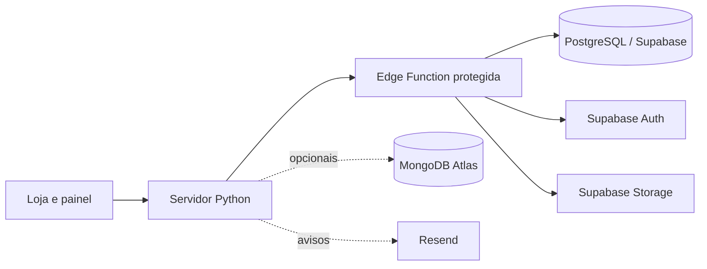

# Estrela Concept

<p align="center"></p>

Loja de moda fitness com catálogo, sacola, registro de pedidos e painel administrativo. O atendimento comercial continua pelo WhatsApp.

[](https://github.com/guilhermeestrela10/estrela-concept/actions/workflows/quality-checks.yml)

[Demonstração](https://estrela-concept.onrender.com/) · [Guia técnico](docs/operacao.md) · [Estrutura](docs/estrutura-do-projeto.md) · [Contribuição](CONTRIBUTING.md)

> **Estado:** demonstração funcional. O catálogo ainda contém exemplos e há integrações e rotinas de produção pendentes. A aplicação registra solicitações; pagamento, frete e confirmação comercial são combinados pelo atendimento.

## Funcionalidades

- Catálogo responsivo, busca, filtros e variações de produtos.
- Sacola persistida no navegador e validação de disponibilidade no servidor.
- Criação de pedidos com baixa transacional de estoque.
- Painel com autenticação, catálogo, imagens, estoque e acompanhamento de pedidos.
- Notificação de pedidos por e-mail, conforme configuração do serviço.
- Métricas agregadas de produtos e assistente de catálogo opcionais.

## Arquitetura



| Camada | Tecnologias |
| --- | --- |
| Interface | HTML, CSS e JavaScript |
| Servidor | Python 3.10+ e biblioteca padrão |
| Dados e identidade | PostgreSQL, Supabase Auth, Storage e Edge Functions |
| Integrações opcionais | PyMongo, pgvector, geração de texto e Resend |

## Executar localmente

```shell
git clone https://github.com/guilhermeestrela10/estrela-concept.git
cd estrela-concept
python -m pip install -r requirements.txt
```

Configure `ESTRELA_EDGE_API_TOKEN` somente no ambiente local. Exemplo no PowerShell:

```powershell
$env:ESTRELA_EDGE_API_TOKEN = "SEU_TOKEN_PRIVADO"
python server.py
```

Abra [localhost:8000](http://127.0.0.1:8000). O acesso aos dados depende do serviço Supabase e de um token válido. Não há troca automática para um banco local quando a integração falha; SQLite é usado pelos testes.

Para configurar um ambiente próprio, consulte o [guia técnico](docs/operacao.md). Não aplique o esquema ou as migrações sobre um banco publicado sem revisar seu estado.

## Testes

```shell
python -m unittest discover -s tests -v
```

A suíte cobre regras e rotas usando armazenamento temporário. O workflow também confere sintaxe Python e JavaScript. Esses testes não confirmam entrega real de e-mails nem funcionamento das integrações externas.

## Documentação

| Guia | Conteúdo |
| --- | --- |
| [Estrutura](docs/estrutura-do-projeto.md) | Aplicação, páginas, recursos e testes |
| [Operação](docs/operacao.md) | Variáveis, serviços, segurança, backup e pendências |
| [Contribuição](CONTRIBUTING.md) | Preparação de alterações e validação |

## Limitações para produção

Configuração do assistente, validação do e-mail e dos backups, revisão dos dados comerciais e rotina de retenção ainda exigem atenção. A lista detalhada permanece no [guia operacional](docs/operacao.md). As credenciais e chaves privadas devem permanecer fora do Git e do navegador.
