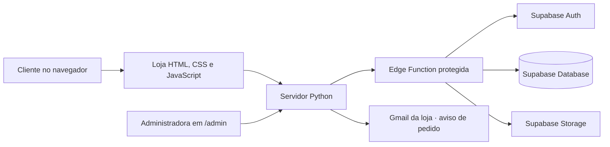

# Estrela Concept

<p align="center">
  
</p>

<p align="center"><strong>Seu estilo, seu brilho.</strong><br>Loja virtual de moda fitness com atendimento próximo pelo WhatsApp.</p>

<p align="center">
  <a href="https://estrela-concept.onrender.com/">Abrir a loja</a> ·
  <a href="https://estrela-concept.onrender.com/admin">Painel administrativo</a> ·
  <a href="https://github.com/guilhermeestrela10/estrela-concept">Repositório no GitHub</a>
</p>

> **Estado do projeto:** demonstração funcional. O catálogo contém produtos de exemplo. Antes de vender ao público, a loja precisa receber o catálogo verdadeiro, políticas finais e uma hospedagem/domínio escolhidos pela proprietária.

## Sobre o projeto

A **Estrela Concept** é uma loja online para apresentar roupas fitness e facilitar pedidos pelo celular ou computador. A vitrine permite explorar as peças e montar uma sacola; o sistema registra o pedido e a equipe combina pagamento, entrega, trocas, devoluções e dúvidas diretamente com a cliente pelo WhatsApp.

O projeto atende dois públicos:

- **Clientes:** navegam pelo catálogo, conferem fotos, tamanhos, cores e disponibilidade e enviam um pedido com nome e WhatsApp.
- **Administradora:** entra em uma página restrita para atualizar produtos, imagens, categorias e estoque, acompanhar pedidos e abrir uma conversa com a cliente.

O site não processa pagamentos, não calcula frete e não confirma uma venda paga. O pedido é o início do atendimento, e as condições são acertadas pelo WhatsApp **+55 86 99926-9836**.

## O que já está implementado

### Loja

- Layout responsivo alinhado à identidade visual aprovada.
- Busca e filtros por categoria, tamanho e faixa de preço.
- Página de detalhes com galeria de fotos e opções de variação.
- Sacola persistida no navegador.
- Validação de disponibilidade no servidor e baixa de estoque transacional ao criar pedido.
- Atalho para continuar o atendimento pelo WhatsApp.

### Painel administrativo

- Acesso pela rota direta `/admin`; o link não é exibido na navegação pública.
- Login, sessão administrativa, saída e fluxo de recuperação de senha pelo Supabase Auth.
- Cadastro e edição de produtos, categorias, preços, variações e estoque.
- Envio de até 10 imagens por produto em JPEG, PNG ou WebP (até 4 MB por arquivo), além de imagens por URL HTTPS.
- Acompanhamento e atualização de status de pedidos, com atalho para chamar a cliente pelo WhatsApp.
- Indicadores calculados a partir dos dados já carregados no painel para evitar uma consulta repetida ao banco.

### Avisos por e-mail

Quando o pedido é gravado, o servidor tenta enviar uma notificação ao Gmail da loja por SMTP seguro. A mensagem mostra os itens, o total e um botão para abrir o painel. Os dados de contato da cliente ficam somente no painel, que exige login. Uma falha no e-mail não cancela o pedido; no momento, avisos com falha não são reenviados automaticamente.

## Como funciona



O navegador conversa com o servidor Python. O servidor usa uma Edge Function para acessar dados e operações administrativas do Supabase. A chave de serviço do Supabase permanece no ambiente Supabase; o token privado usado pelo servidor é configurado como segredo na hospedagem. As fotos do catálogo ficam no Supabase Storage.

## Tecnologias

| Parte | Tecnologia |
| --- | --- |
| Vitrine e painel | HTML, CSS e JavaScript nativos |
| Servidor web e API | Python 3.10+ e biblioteca padrão |
| Dados e autenticação | Supabase Database e Supabase Auth |
| Fotos | Supabase Storage |
| Operações protegidas | Supabase Edge Functions e PostgreSQL |
| Hospedagem atual | Render |
| Testes automatizados | `unittest` e SQLite temporário |

Não há dependências Python externas para instalar.

## Executar localmente

### Requisitos

- Python 3.10 ou superior.
- Token privado `ESTRELA_EDGE_API_TOKEN` configurado para conectar ao Supabase.

O servidor pode ler o token do arquivo `%LOCALAPPDATA%\Estrela Concept\edge_api.key`. Como alternativa, configure-o apenas na sessão atual do PowerShell:

```powershell
$env:ESTRELA_EDGE_API_TOKEN = "SEU_TOKEN_PRIVADO"
python server.py
```

Abra no navegador:

- Loja: <http://127.0.0.1:8000>
- Painel: <http://127.0.0.1:8000/admin>
- Estado da conexão: <http://127.0.0.1:8000/api/status>

O servidor usa `127.0.0.1:8000` por padrão. `HOST` e `PORT` podem ser configurados por variáveis de ambiente. Encerre com `Ctrl+C` no terminal.

Se o Supabase não estiver acessível ou o token não estiver configurado, as rotas de dados exibem um erro. O sistema não troca silenciosamente para outro banco. SQLite é utilizado pelos testes.

## Configuração do serviço publicado

O serviço Render utiliza as seguintes variáveis de ambiente. Cadastre os valores privados diretamente no painel do Render; não os grave neste repositório.

| Variável | Uso |
| --- | --- |
| `ESTRELA_EDGE_API_TOKEN` | Segredo para o servidor chamar a Edge Function |
| `GMAIL_SMTP_USER` | Conta Gmail que envia os avisos |
| `GMAIL_APP_PASSWORD` | Senha de app do Gmail, armazenada como segredo |
| `ORDER_NOTIFICATION_EMAIL` | Endereço que recebe os avisos de novos pedidos |
| `ADMIN_PANEL_URL` | Link do painel incluído no e-mail; padrão atual: `https://estrela-concept.onrender.com/admin` |
| `HOST` / `PORT` | Endereço e porta do servidor; o Render define a porta |

Para enviar e-mails, é necessária uma senha de app do Google, não a senha normal da conta. A conta precisa ter a verificação em duas etapas habilitada. Consulte a [ajuda oficial do Google sobre senhas de app](https://support.google.com/mail/answer/185833). Ative também as notificações do Gmail no celular da loja.

## Banco e arquivos do Supabase

O projeto já utiliza o Supabase associado à loja. O arquivo `supabase/schema.sql` descreve tabelas, regras e operações do banco; não o execute novamente no projeto publicado sem verificar as migrações existentes. A função `supabase/functions/estrela-api/` implementa operações protegidas, como login administrativo, pedidos, atualização do catálogo e upload de imagens.

O catálogo existente contém dados de demonstração. O arquivo `catalog.py` oferece dados usados no armazenamento temporário dos testes, não é o cadastro oficial dos produtos publicados.

## Segurança e privacidade

- Segredos de servidor não são enviados ao navegador nem devem ser commitados.
- Operações administrativas e dados de pedidos exigem sessão autenticada.
- O painel utiliza cookies de sessão com validade limitada e proteção contra requisições de outras origens.
- A criação de pedido valida os dados e atualiza o estoque em uma transação no banco.
- O upload de imagens verifica formato, conteúdo e tamanho.
- O e-mail de aviso não inclui telefone nem outros dados pessoais da cliente.
- O servidor envia resposta genérica para falhas internas e registra detalhes técnicos somente nos logs.

**Limite conhecido:** a proteção do Supabase contra senhas vazadas não está habilitada no plano atual. As credenciais administrativas também foram compartilhadas durante a configuração da demonstração. Reavalie a troca da senha e das chaves compartilhadas, e ative proteções disponíveis, antes de abrir a loja ao público.

### Políticas para revisão

A rota [`/politicas`](https://estrela-concept.onrender.com/politicas) reúne rascunhos de privacidade, pagamento e entrega, trocas e devoluções. A página está marcada como rascunho e não deve ser considerada política jurídica final. Antes da abertura ao público, a responsável precisa conferir o texto e completar endereço físico, dados cadastrais, regiões de entrega, modalidades, custos, prazos, regras práticas de devolução e prazos de retenção dos dados. O texto preserva o direito legal de arrependimento nas compras online.

### Backup automático do banco

O projeto Supabase está no plano Free, que não oferece backups automáticos diários para download. O repositório inclui o fluxo [`supabase-backup.yml`](.github/workflows/supabase-backup.yml), que pode gerar uma cópia semanal ou manual do banco e publicar somente um arquivo criptografado com GPG. Como o repositório é público, qualquer pessoa pode baixar o artefato, mas não consegue ler seu conteúdo sem a senha. Os artefatos ficam no GitHub por 30 dias.

Para ativar, abra **GitHub → Settings → Secrets and variables → Actions → New repository secret** e cadastre:

| Nome do segredo | Valor |
| --- | --- |
| `SUPABASE_DB_URL` | String de conexão do banco obtida em Supabase → Connect; prefira a string do Session Pooler. Não a publique nem a envie por mensagem. |
| `BACKUP_ENCRYPTION_PASSPHRASE` | Senha aleatória exclusiva com pelo menos 24 caracteres. Guarde-a fora do GitHub: sem ela, não será possível abrir os backups. |

Depois, acesse **Actions → Backup criptografado do Supabase → Run workflow** para fazer a primeira execução. O agendamento semanal começa após os dois segredos serem cadastrados. Para restaurar, baixe o artefato e use `gpg --decrypt estrela-supabase-backup.tar.gz.gpg > estrela-supabase-backup.tar.gz`; extraia o arquivo e use os SQL em um projeto de recuperação depois de conferir o destino. Faça um teste de restauração antes de depender desse processo em produção.

**Limite deste backup:** o Supabase CLI exclui os esquemas gerenciados `auth` e `storage`; imagens guardadas no Supabase Storage não entram nesta cópia. Mantenha os arquivos originais das fotos fora do Supabase até existir uma rotina específica de backup do Storage. Consulte a [documentação oficial do Supabase](https://supabase.com/docs/guides/platform/backups).

## Testes

Na pasta do projeto, execute:

```powershell
python -m unittest discover -s tests -v
```

Os testes cobrem login e sessão, recuperação de senha no servidor, respostas de erro, validação de pedidos, estoque, upload e operações de catálogo no SQLite temporário. Eles não fazem compras reais, não enviam e-mails e não substituem a validação da implantação com o Supabase.

## Mapa dos arquivos

| Caminho | Finalidade |
| --- | --- |
| `index.html` | Página principal da loja |
| `politicas.html` | Rascunhos de privacidade e políticas comerciais |
| `admin.html` | Interface administrativa restrita |
| `server.py` | Servidor web, segurança HTTP, rotas e avisos por e-mail |
| `store.py` | Comunicação com o Supabase e armazenamento SQLite para testes |
| `catalog.py` | Produtos de exemplo usados nos testes locais |
| `static/app.js` | Catálogo, filtros, sacola e checkout |
| `static/admin.js` | Login, catálogo, imagens e pedidos no painel |
| `static/styles.css` | Aparência responsiva |
| `static/brand-horizontal.png` | Logo horizontal da marca usada neste README |
| `supabase/schema.sql` | Definição do esquema e das operações SQL |
| `supabase/functions/estrela-api/index.ts` | API protegida no Supabase |
| `render.yaml` | Configuração do serviço Render |
| `tests/` | Testes automatizados |
| `.github/workflows/supabase-backup.yml` | Fluxo semanal e manual para backup criptografado do banco |

## Publicação e domínio

O código está conectado ao repositório GitHub e à hospedagem atual no Render. A URL `onrender.com` é adequada para demonstração e pode ser substituída por um domínio próprio depois. O plano gratuito do Render pode suspender o serviço após inatividade; a primeira visita após a pausa pode demorar. Projetos gratuitos do Supabase também podem ser pausados por inatividade.

### Migração futura para a Hostinger

A migração será planejada quando a proprietária escolher e contratar um plano Hostinger. Antes de mover o site, vamos confirmar que o plano aceita o servidor Python e o modo de execução necessários. A migração deverá configurar variáveis secretas, HTTPS, domínio e redirecionamentos de recuperação no Supabase, testar o painel, pedidos, estoque, imagens e notificações de e-mail, mantendo o Supabase como banco enquanto for adequado. Não é necessário comprar domínio agora; ele pode ser conectado depois.

## O que falta antes de vender ao público

1. Cadastrar produtos verdadeiros: fotos, descrições, preços, tamanhos, cores e estoque.
2. Escolher e contratar domínio e hospedagem permanentes.
3. Revisar e finalizar as políticas em `/politicas`, incluindo os dados da empresa e as condições comerciais que ainda faltam.
4. Cadastrar os dois segredos do GitHub Actions e confirmar uma execução de backup bem-sucedida; planejar cópia independente das imagens no Supabase Storage.
5. Trocar a senha de administrador e as chaves que foram compartilhadas, habilitar a proteção contra senhas vazadas quando o plano permitir e revisar MFA/contas com acesso ao Supabase.
6. Conferir a lista de URLs permitidas para recuperação de senha no Supabase e validar o envio de e-mails.
7. Fazer uma revisão final no domínio definitivo em computador e celular, sem criar pedidos reais desnecessários.

**Combinado:** quando domínio, hospedagem, catálogo e políticas estiverem definidos, fazer uma revisão final de segurança, backups e funcionamento antes da divulgação pública.
